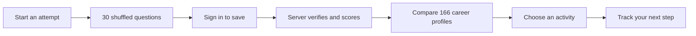

<p align="center">
  
</p>

# Abilitio

**A career direction should come with reasons—and something you can try.**

Abilitio helps students explore their interests, work preferences and reasoning, compare career directions, and turn a suggestion into a practical activity. Schools can support the same journey through student reports and class tools. The interface is available in English, Russian and Uzbek.

[](https://github.com/abdugamer009-arch/abilitio/actions/workflows/verify.yml)

[Visit Abilitio](https://abilitio-xt4n.vercel.app/) · [Try the assessment](https://abilitio-xt4n.vercel.app/career-assessment) · [Architecture](docs/development/ARCHITECTURE.md) · [Documentation](docs/README.md)

## The product, at a glance

| Explore                   | What is in the repository                                                                                                             |
| ------------------------- | ------------------------------------------------------------------------------------------------------------------------------------- |
| **Find your signals**     | 561 catalog questions: 280 personality statements, 260 reasoning questions and 21 visual-interest questions. Each attempt selects 30. |
| **Compare directions**    | All 166 canonical career profiles are ranked in new results, with explanations, search and a Show all careers control.                |
| **Choose a next step**    | 52 seeded study-major profiles, career activities and a roadmap task journal.                                                         |
| **Research universities** | 20 university entries and browser-local research bookmarks.                                                                           |
| **Support a group**       | School enrollment, reports, analytics and class-building tools with owner-scoped access.                                              |

These are catalog counts, not user-impact statistics. Results are exploratory descriptions, not clinical measurements, admission predictions or proof of ability. Some wordplay questions retain English stimuli with translated instructions.

## From answers to action



An attempt contains **12 personality + 9 reasoning + 9 interest questions**. Questions and reasoning/interest answer positions shuffle; repeated questions across different attempts remain possible. Correct answers and scoring weights stay on the server. Signed attempts expire after 24 hours, and retrying a saved attempt returns its original result.

## Run it locally

Use **Node.js 22+** and npm. The committed npm lockfile is the dependency source of truth.

```sh
git clone https://github.com/abdugamer009-arch/abilitio.git
cd abilitio
npm ci --legacy-peer-deps
npm run dev
```

Open [localhost:8080](http://localhost:8080). Public pages and anonymous assessment questions work without backend credentials. For authenticated features, copy `.env.example` to `.env` and follow the [local setup guide](docs/development/LOCAL_SETUP.md).

```sh
npm run check                         # lint, types, application tests, export checks
npm run test:unit                     # fast logic and contract checks
npm run test:integration              # database migrations in local PGlite
NITRO_PRESET=node-server npm run build # standalone Node deployment
PORT=8090 node .output/server/index.mjs
```

Vercel uses `vercel.json`; `VERCEL=1 npm run build` selects the Vercel output. See [contributing](CONTRIBUTING.md) for the change and verification workflow.

## A map of the code

```text
abilitio/
├── src/
│   ├── routes/              # TanStack file-based pages and app shell
│   ├── components/          # shared interface, illustrations and dashboard UI
│   ├── lib/                 # feature logic, scoring, localization and server functions
│   └── integrations/        # authenticated Supabase clients and database types
├── tests/
│   ├── unit/                # scoring, catalogs, localization and session contracts
│   └── integration/         # migration, permissions and rollback checks
├── public/                  # shipped images, fonts and site metadata
├── supabase/
│   ├── migrations/          # ordered database history
│   └── fixes/               # focused repair SQL
├── scripts/migration/       # source backup tooling; no provider cutover
├── docs/
│   ├── development/         # architecture, setup and routing
│   ├── operations/          # release requirements and validation records
│   └── design/              # historical design decisions and audits
├── .github/                 # CI and pull request template
├── AGENTS.md                # repository rules for future coding agents
└── CONTRIBUTING.md          # human contributor workflow
```

Tool configuration remains at the root where Vite, TypeScript, npm and Vercel expect it. `src/lib/` is organized by feature—assessment, schools, community, roadmap, admin and ABBI—so related server functions and domain logic stay together.

| Layer        | Choice                                                |
| ------------ | ----------------------------------------------------- |
| Application  | React 19, TypeScript, TanStack Start and Router       |
| Interface    | Tailwind CSS, illustrated SVG scenes, GSAP and Lenis  |
| Data         | Supabase authentication, PostgreSQL and storage       |
| Delivery     | Vite, Nitro and Vercel                                |
| Verification | Vitest, PGlite, ESLint, TypeScript and GitHub Actions |

## Release status and honest limits

The full question and career catalogs are deployed. **A code deployment does not apply database migrations.** The fresh Supabase project has all 26 migrations, 27 app tables, 166 careers and 52 study majors. Live signup API, browser login, assessment save/reload and cross-account result isolation passed the [October 11 production audit](docs/operations/LIVE_AUDIT_2026_10_11.md). Admin moderation and principal enrollment/class saving also passed dedicated live checks. Email delivery and password recovery still need an owned sender domain and SMTP configuration. See the [current setup record](docs/operations/SUPABASE_SETUP.md) and [owner migration guide](docs/operations/OWNER_MIGRATIONS.md).

- Production still uses Supabase. Nhost work consists of source-backup preparation; no completed transfer is claimed.
- Historical results preserve their original scores and saved career rankings. New results use scoring version `v2`.
- ABBI is a curated English-language guide. Weekly email digest delivery has no configured implementation.
- Local database tests simulate Supabase-owned schemas. Passing them does not prove production permissions, email delivery or real account persistence.
- Never commit credentials or backups. Service-role and assessment-signing keys are server-only.

## Where to go next

**Changing a feature?** Read the [architecture map](docs/development/ARCHITECTURE.md), then its module under `src/lib/` and relevant tests. **Preparing a release?** Read the [operations guides](docs/README.md#operations). **Understanding the interface?** Read the [design archive](docs/README.md#design-history). **Continuing work with a coding agent?** Start with [AGENTS.md](AGENTS.md).
