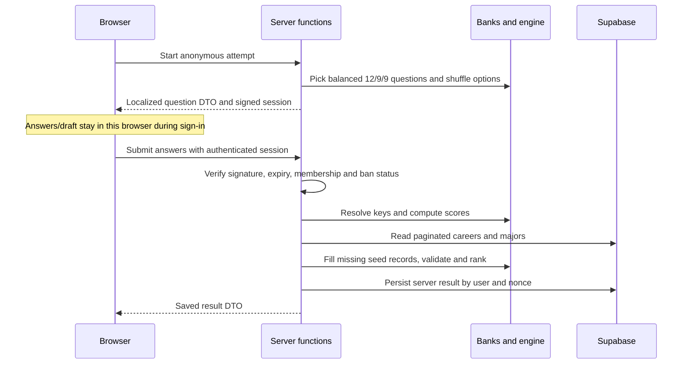

# Architecture and feature map

Abilitio is a React application built with TanStack Start. Routes render the interface; feature modules contain domain logic and server functions; Supabase supplies authentication, PostgreSQL and storage. Nitro packages the server for Vercel or standalone Node.

## Entry points

| File                    | Responsibility                                                |
| ----------------------- | ------------------------------------------------------------- |
| `src/routes/__root.tsx` | App shell, providers, global metadata and fonts               |
| `src/router.tsx`        | Router setup using the generated route tree                   |
| `src/start.ts`          | Request error handling and function authentication attachment |
| `src/server.ts`         | SSR error wrapper                                             |
| `src/routeTree.gen.ts`  | Generated route registry; never edit manually                 |
| `vite.config.ts`        | Framework wrapper, development port and Nitro target          |
| `vercel.json`           | Vercel install/build commands                                 |

## Find the right feature

Paths below are relative to the repository root.

| Feature             | UI entry                                                    | Logic and data                                                                                       |
| ------------------- | ----------------------------------------------------------- | ---------------------------------------------------------------------------------------------------- |
| Public practice     | `src/routes/index.tsx`, `src/components/CareerWorkshop.tsx` | `src/lib/assessment/sample-questions.ts`, `src/lib/roadmap/roadmap-world.ts`                         |
| Assessment          | `src/routes/career-assessment.tsx`                          | `src/lib/assessment/career.functions.ts`, `question-bank.ts`, translations, `session.server.ts`      |
| Scoring and results | `src/routes/career-results.tsx`                             | `src/lib/assessment/career-engine.ts`, `catalog.ts`, `catalog.server.ts`, `result-storage.server.ts` |
| Dashboard           | `src/routes/dashboard.tsx`                                  | Assessment/roadmap server functions and `src/components/dashboard/`                                  |
| Roadmap             | `src/routes/roadmap.tsx`                                    | `src/lib/roadmap/tasks.functions.ts`, `useTaskJournal.ts`                                            |
| Schools             | `src/routes/school.*.tsx`                                   | `src/lib/schools/`, assessment school overview functions                                             |
| Community           | `src/routes/community.tsx`                                  | `src/lib/community/community.functions.ts`                                                           |
| Admin               | `src/routes/admin.tsx`                                      | `src/lib/admin/admin.functions.ts`                                                                   |
| ABBI                | `src/routes/abbi.tsx`, `src/components/AbbiChat.tsx`        | `src/lib/abbi/`: curated knowledge and server actions                                                |
| Universities        | `src/routes/universities.tsx`                               | Static research catalog and browser-local bookmarks                                                  |
| Authentication      | `src/routes/auth.tsx`                                       | `src/lib/auth-context.tsx`, `src/integrations/supabase/`                                             |
| Localization        | Routes and shared components                                | `src/lib/i18n.tsx`, legal/workshop/question translations                                             |

Older `/assessment`, `/iq-test` and `/results` routes coexist with the career flow. Check their actual behavior before removing them or changing links.

## Assessment data flow

The full bank and hidden answer keys stay on the server. Signed option permutations map displayed positions back to canonical answer keys. Repaired questions have versioned IDs so older signed attempts remain gradable. New results include all 166 canonical careers; historical stored rankings are not rewritten.

`catalog.server.ts` is derived from SQL seed content. Database records override matching keys and additional records remain available. Reads still surface errors, and `catalog.ts` validates the combined records before matching. Changes to canonical seed content must keep the SQL and server catalog consistent.

`result-storage.server.ts` uses the service-role client only after authentication, membership checks and server computation. A matching owner/nonce unique conflict recovers the saved result rather than creating another row. Other conflicts remain errors.

`result-interest-profile.ts` reads the persisted six-dimension profile for new results. Historical rows without it use an explicitly labelled estimate from their stored field weights. `account-load.ts` discards cancelled result requests and the route gates state by the current account. Browser storage cleanup after an acknowledged save is best effort.

## Data and authorization boundaries

- The public client uses the publishable key. Authenticated queries use user context and database RLS.
- The service-role client bypasses RLS and belongs only in trusted server functions/routes. Explicit authorization remains necessary.
- `user_roles` determines administrative access. School ownership and enrollment restrict principal visibility.
- `src/lib/db-read.ts` handles pagination and visible failures; a failed read must not resemble an empty account.
- Roadmap journals use per-account local queues and cloud reconciliation. University bookmarks and practice state are local browser data.
- `supabase/migrations/` is the schema source of truth. Generated TypeScript types alone do not prove a live schema has been migrated.

## Rendering and deployment

The Vite wrapper supplies the framework plugins; duplicating them breaks the build. `BrainScene.tsx` retains a lazy client canvas boundary with a fallback. Keep browser-only rendering code out of eager SSR imports.

Vercel uses the configured production branch and the `VERCEL=1` Nitro preset. Standalone Node uses `NITRO_PRESET=node-server`. Both need matching backend environment variables for authenticated features. Production signing requires a stable server-only secret or service-role key; development can use an ephemeral key that becomes invalid after a server restart.

## Verification map

- `tests/unit/`: scoring, question coverage, localization, catalog validation, signed sessions, retries, read helpers and school models.
- `tests/integration/migration.test.ts`: the migration chain and release repair in PGlite, including permissions and rollback behavior.
- `scripts/migration/export-source.checks.mjs`: separate Node checks for backup tooling.
- `.github/workflows/verify.yml`: `npm run check` and the standalone Node build.

See [local setup](LOCAL_SETUP.md) for commands and [owner migrations](../operations/OWNER_MIGRATIONS.md) for actual staging/production verification. Local and simulated database checks do not establish live persistence.
